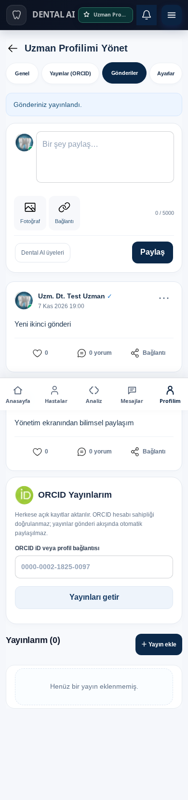
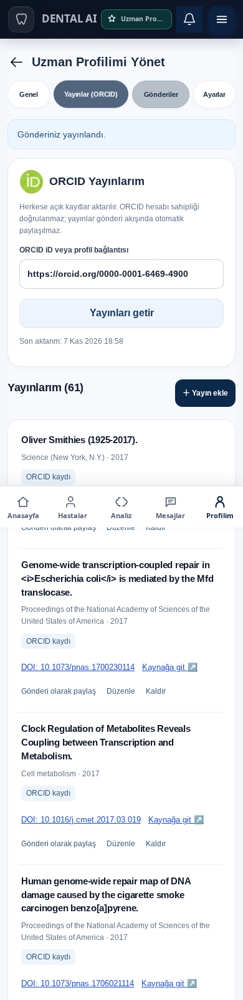
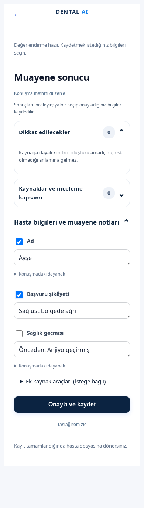

# Uzman profili ve sesli muayene takip çalışması

Çalışma dalı: feature/expert-publications-feed-20261107. PR #250 taslak olarak kalır; main birleştirilmedi, Render dağıtımı yapılmadı.

## Değişiklikler

- Profil/yönetim şablonları, expert-social.css/js, referans görseli ve MIT lisanslı Phosphor simgeleri: verilen kompozisyona yakın kapak/avatar, rozetler, gerçek sayaçlar, sekmeler ve satır içi editör. Yayın ekleme, gönderiye taşıma, düzenleme/iptal, araçların tekrar açılması ve mevcut müsaitlik ayarı çalışır. Danışmanlık akışları korunur.
- expert_publications.py ve expert_social_safety.py: resmi ORCID/Crossref/PubMed/DergiPark adreslerine sınırlı TLS istemcisi; yönlendirme yok, süre/gövde sınırı var. Yapıştırılan diğer adresler ve bütün görseller DNS sabitlemeli SSRF istemcisinde kalır. PubMed başlığı resmi ESummary API’den alınabilir.
- expert_social_models/api/schema/maintenance: gerçek idempotent takip sistemi ve istatistikler; hesap silmede temizlik; sosyal şema sürümü 2 (temel sürüm 12 korunur). 1→2 yükseltmesi test edildi. Yayını gönderiye taşırken kayıtlı başlık/dergi/yıl bağlantı kartına hazır gelir; harici önizleme zorunlu değildir.
- voice_exam.py, voice_exam_panel.html, voice-exam.css/js: daha kısa sonuç ekranı, tekrarsız alanlar, katlanabilir dayanak, tek Onayla ve kaydet. Hasta kaydı atomik commit edildikten sonra bildirim yayını yanıt sonrasına alınır. Kaydetmede tekrar AI çağrısı yapılmaz; ağ/veritabanı süresi için sıfır gecikme iddiası yoktur. Başarısızlıkta taslak korunur. Önceki kayıt ekleme/yarım taslak geri yüklemede mikrofon görünür kalır.

## Gerçek yayın testi

Aziz Sancar: https://orcid.org/0000-0001-6469-4900 . Kimlik çapraz kontrol kaynağı: https://reactome.org/content/detail/person/5651758 . Test yerel uzman hesabında yapılmıştır; üretim hesabına bu kişinin kimliği bağlanmadı, yazarlık/sahiplik rozeti verilmedi.

ORCID Public API’den 61 eser alındı, yönetim ekranında kaydedildi; ikinci eşitlemede yeni kopya oluşmadı. Manuel aynı DOI reddedildi. İçeri aktarılan yayın kendi açıklamasıyla gönderiye dönüştürüldü. Gerçek PubMed makale önizlemesi ve Crossref DOI eşleşmesi de geçti. Canlı ağ + yükseltme komutu: 7 test geçti. Bu testler dış servise bağımlı olduğundan CI’da varsayılan kapalıdır (TEST_LIVE_ORCID=1).

## Doğrulama

Güncel kapsamlı komut: sosyal API/güvenlik/temizlik/migration/PostgreSQL/tarayıcı testleri, mevcut danışmanlık/kimlik/yönetici/depolama testleri ve sesli muayene/sonuç/anamnez/panel testleri. **310 geçti, 4 canlı servis testi varsayılan olarak atlandı** (63,63 saniye). Ayrı canlı API/UI ve migration komutunda **7 test geçti**. JavaScript sözdizimi ve git diff --check kontrolleri geçti.

Görsel ve davranış kontrolü: docs/design-qa.md. Yeni regresyonlar: düzenleme iptalinde yeni taslağın geri gelmesi, sekme sonrası editör durumunun sıfırlanması, geçmiş aktarımında mikrofonun kalması, tek düğmeyle gerçek hasta kaydı ve bildirim beklememe; yayın kartı sahiplik yetkisi, gerçek takip sayımları.

Genel deponun önceki geniş test sonucu yeşil değildir; başlangıç koduyla karşılaştırılan hatalar ana raporda listelidir. Bu takip çalışması kapsam dışı akademik sorunların tamamlandığı iddiasını taşımaz.

## Kalan sınırlar

Gerçek üretim R2 kovasına yükleme ve fiziksel iPhone/Android klavyeleri denenmedi. Görseller insan incelemesine gider; kural tabanlı metin taraması tüm kişisel bilgi ve mesleki mevzuat risklerini garantiyle tespit edemez. ORCID OAuth sahipliği ve periyodik otomatik eşitleme yoktur. Mevcut gönderiyi düzenlemek metin içindir; medya bileşimini yeniden düzenlemek desteklenmez. Arayüz referansla aynı görsel kompozisyonu kullanır; piksel eşitliği olarak sunulmaz.

