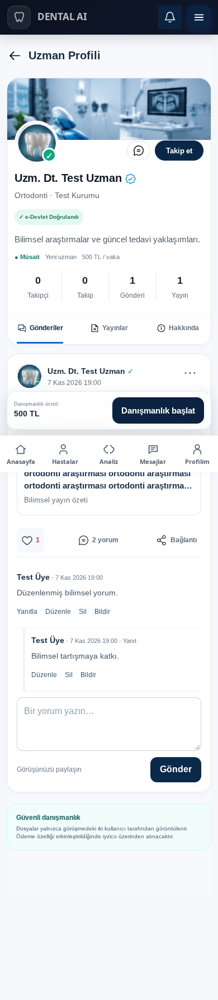
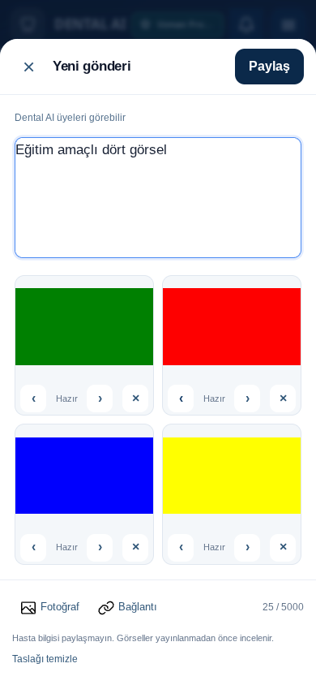
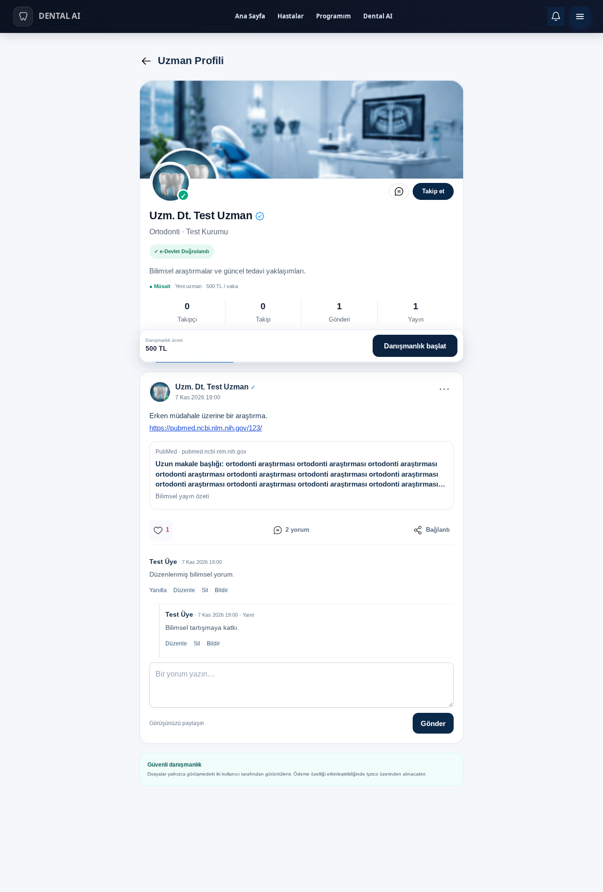

> Güncel yayın sonrası onarım, yük ve sesli muayene sonuçları: [7 Kasım takip raporu](postlaunch_social_voice_2026-11-07.md). Aşağıdaki rapor ilk geliştirme tesliminin tarihsel kaydıdır.

# Uzman sosyal profili — geliştirme ve doğrulama

Bu değişiklik geliştirme dalındadır. Main birleştirmesi ve canlı dağıtım yapılmadı.

## Uygulanan akış

- Mevcut danışmanlık kartları, performans, mesleki doğrulama ve danışmanlık başlatma alanları korunur. Profilde Gönderiler, Akademik Yayınlar ve Hakkında sekmeleri aynı sayfada açılır. Sahibi yönetim ekranından veya kendi profilinden paylaşabilir.
- 5.000 karakter metin, en fazla dört görsel, önizleme, sıralama, kapak seçimi, yükleme ilerlemesi ve hata durumu; sekme oturumuna ve kullanıcıya bağlı taslak korunması; çift paylaşımı engelleyen sunucu/veritabanı anahtarı.
- JPEG/PNG/WebP gerçek içerik doğrulaması, 8 MB ve 20 MP sınırları, en fazla 2048 px JPEG yeniden kodlama ve EXIF/GPS/XMP temizliği. Render'da R2 kapalıysa yükleme reddedilir. Medyaya erişim oturum, sahiplik ve yayın durumuyla doğrulanır.
- HTTPS bağlantı kartı, sayfa başlığı/açıklaması/site adı ve varsa sunucuda temizlenen görsel. Özel/yerel/metadata IP adresleri, karışık DNS cevapları ve her yönlendirme kontrol edilir. DNS sonucu bağlanılacak IP'ye sabitlenir. Süre, gövde, yönlendirme ve eşzamanlılık sınırları vardır. Önizleme başarısızsa sade bağlantı paylaşılır.
- Gönderi metnini düzenleme, silme, tek gönderi sabitleme, yorumları açma/kapatma, cursor akışı, idempotent beğeni, yorum/tek seviyeli yanıt, kendi yorumunu düzenleme/silme, uzmanın yorum kaldırması, bildirim ve gönderi bağlantısını kopyalama.
- Yapılandırılmış manuel yayın CRUD; ORCID biçim/kontrol hanesi ve Public API works aktarımı; DOI/Crossref bilgilerini doldurma; sunucunun verdiği eşleşme kaydıyla DOI kaynağı etiketi. DOI, başlık/yıl ve ORCID kaynak kimliğinde tekrar engeli. Yayınlar kendiliğinden gönderiye dönüşmez. Önceki serbest yayın metni korunur.
- Kaynak etiketleri ORCID kaydı / DOI ile eşleşen kayıt / Manuel ekleme şeklindedir. ORCID veya DOI bilgisi hesap sahipliğini ya da yazarlığı doğrulamaz. İçe aktarılan kaydı manuel değiştirmek kaynak etiketini manuel yapar.
- Metin, bağlantı önizleme alanları, yorum ve manuel yayın için yerel kural tabanlı risk taraması. Klinik terimler otomatik yanlış sayılmaz. Bütün görseller ilk sürümde insan incelemesine gider. Sağlık iddialarının doğruluğu ve hukuki uygunluk otomatik garanti edilmez. İçerik harici AI sağlayıcısına gönderilmez.
- Mevcut yönetim merkezinden MFA korumalı gönderi/yorum/yayın kuyruğu, şikâyetler ve karar geçmişi. Kararlar ve düzenlemeler sürüm kontrollüdür; PostgreSQL satır kilitleri eski içerik üzerinden onayı engeller.
- Silinen gönderi medyası aynı işlemde kalıcı silme kuyruğuna alınır; depolama hatası veya yeniden başlama sonrasında yeniden denenir. Yüklenip paylaşılmayan görseller 24 saat sonra, geçici önizleme/DOI önerileri iki gün sonra temizlenir. Hesap silme yeni sosyal kayıtları da temizler.

## Dosyalar ve dağıtım

Yeni modüller: expert_social_models.py, expert_social_schema.py, expert_publications.py, expert_social_safety.py, expert_social_api.py ve expert_social_maintenance.py. Yeni kapsamlı arayüz dosyaları expert-social.css / expert-social.js / expert-social-admin.js ve iki Jinja şablonudur.

Mevcut main.py yalnızca kayıt/startup kontrolüyle, migrate.py sosyal migration çağrısıyla, account_erasure.py sosyal içerik temizliğiyle genişletildi. Üç mevcut profil/yönetim şablonu yeni bölüme bağlandı. Danışmanlık iş kuralları değiştirilmedi. Üretim bağımlılığı eklenmedi; mevcut aiohttp/Pillow/SQLModel/R2 altyapısı kullanılır.

Ön dağıtım komutu `python -m app.migrate` önce mevcut migration'ı, sonra advisory lock içinde yeni sosyal tabloları oluşturur. Mevcut çalışan worker'larla uyumluluk için temel şema sürümü 12 olarak kalır. Web başlangıcı ayrıca sosyal şema sürümünü ve bütün tabloların varlığını kontrol eder; eksik tablolarla trafik kabul etmez. Render yapılandırmasındaki mevcut preDeployCommand korunmuştur. Bu komut üretimde çalıştırılmadı.

## Test kanıtı

İlk teslimde hedeflenen özellik ve mevcut akış testleri: **199 geçti**. Profil/sesli muayene takip çalışmasının güncel sonuçları ve ekranları [takip raporundadır](expert_profile_voice_followup_2026-11-07.md). Testler SQLite, gerçek PostgreSQL 16, gerçek başsız Chromium ve mevcut FastAPI oturum/MFA koduyla çalıştırıldı. PostgreSQL testleri migration tekrarını, eksik şemada başlangıç reddini, temel sürüm 12'den release migration'ını, eşzamanlı çift paylaşımı, tek sabitleme kuralını ve yayın düzenleme/yönetici kararı yarışını kapsar.

360/390/430 px ve 1280 px tarayıcı akışları: taslak/yeni yükleme, bağlantı kartı, çift tıklama, uzun başlık/URL, yayın ekleme, yayını gönderiye taşıma, normal üye görünümü, danışmanlık bağlantısı, yorum/yanıt/düzenleme, beğeni, dört görsel/sıralama, çevrimdışı hata ve tekrar gönderim. Yatay taşma kontrol edildi. Mevcut zil, menü ve alt gezinme korundu.

Bağımsız incelemede önizleme metninin denetimi aşması ve yayın düzenleme/moderasyon yarışması bulundu; önce başarısız testlerle doğrulandı, sonra düzeltildi. Yorum düzenlemesi sonrası ekrandaki sayaç da tarayıcı testiyle doğrulandı.

Genel depo testi yeşil değildir: değişiklik dalında 2.145 geçti, 80 başarısız, 49 atlandı; ayrıca 594 alt senaryo geçti. Aynı ortamda başlangıç kodu 2.090 geçti, 81 başarısız, 48 atlandı sonucu verdi. Başarısız test kimlikleri karşılaştırıldığında yalnızca bu değişiklikte görülen yeni başarısızlık yoktu. Hatalar akademik üretim, bazı sesli akış/istemci kontrolleri ve eksik test veri/bağımlılıklarına ilişkindir; bu görev kapsamında başka ürün akışlarına müdahale edilmedi. Tam başarısızlık listesi aşağıdadır.

## Kalan doğrulamalar ve sınırlar

- ORCID/Crossref kontrollü testlerine ek olarak gerçek servis testleri tamamlandı: Aziz Sancar’ın 0000-0001-6469-4900 kaydından 61 yayın yönetim ekranıyla aktarıldı; tekrar aktarım ve aynı DOI engeli geçti. PubMed önizlemesi ve Crossref eşleşmesi gerçek servislerden doğrulandı.
- Mevcut R2 servisi ve hata davranışı test edildi; gerçek üretim kovasına test içeriği yüklenmedi.
- Fiziksel iPhone/Safari ve Android ekran klavyeleri test edilmedi. Chromium mobil görünümü ve VisualViewport uyarlaması test kapsamındadır.
- Kural tabanlı metin denetimi tüm kişisel bilgileri, kötüye kullanımı veya yanlış sağlık iddialarını yakalama garantisi vermez. Görsellerin insan incelemesi ihtiyatlı ilk sürüm politikasıdır; içerik onayının hukuki/mesleki değerlendirmesi ayrıca yapılır.
- ORCID sahiplik OAuth bağlantısı, video/dosya/anket, yeniden paylaşım ve otomatik periyodik ORCID eşitlemesi eklenmedi. Gönderi düzenleme metni kapsar; mevcut gönderinin medya/bağlantı bileşimini değiştiren editör bu sürümde yoktur.

## Test ekran görüntüleri

Bu görüntüler yalnızca yerel test verisidir; canlı kullanıcı, yayın veya sayaç değildir.







## Genel depo testindeki başarısızlıklar

```text
FAILED tests/academic_v2/test_batch_generation.py::test_summary_and_teaching_combine_all_sections_before_final_format[summarize]
FAILED tests/academic_v2/test_batch_generation.py::test_summary_and_teaching_combine_all_sections_before_final_format[teach]
FAILED tests/academic_v2/test_batch_generation.py::test_question_count_applies_once_after_all_sections_are_read
FAILED tests/academic_v2/test_batch_generation.py::test_unsupported_batch_does_not_append_denial_to_supported_answer[outputs0]
FAILED tests/academic_v2/test_batch_generation.py::test_unsupported_batch_does_not_append_denial_to_supported_answer[outputs1]
FAILED tests/academic_v2/test_batch_generation.py::test_all_unsupported_batches_produce_one_honest_reply
FAILED tests/academic_v2/test_batch_generation.py::test_comparison_synthesis_sees_both_files_and_preserves_original_request
FAILED tests/academic_v2/test_batch_generation.py::test_failed_comparison_extraction_does_not_emit_a_misleading_partial_result
FAILED tests/academic_v2/test_batch_generation.py::test_parallel_question_sections_overlap_but_synthesize_in_source_order
FAILED tests/academic_v2/test_batch_generation.py::test_parallel_failure_never_synthesizes_or_schedules_remaining_sections
FAILED tests/academic_v2/test_batch_generation.py::test_question_request_recovers_only_failed_section_once
FAILED tests/academic_v2/test_batch_generation.py::test_recovery_is_bounded_and_never_synthesizes_incomplete_sources[quota]
FAILED tests/academic_v2/test_batch_generation.py::test_recovery_is_bounded_and_never_synthesizes_incomplete_sources[partial]
FAILED tests/academic_v2/test_batch_generation.py::test_recovery_is_bounded_and_never_synthesizes_incomplete_sources[second_failed_section]
FAILED tests/academic_v2/test_batch_generation.py::test_recovery_is_bounded_and_never_synthesizes_incomplete_sources[retry_failed]
FAILED tests/academic_v2/test_batch_generation.py::test_multi_section_answer_is_synthesized_once_instead_of_joining_denials
FAILED tests/academic_v2/test_batch_generation.py::test_final_synthesis_retains_native_values_even_if_extraction_omits_them
FAILED tests/academic_v2/test_chat_markdown.py::test_interrupted_stream_keeps_partial_answer_restores_request_and_disables_export
FAILED tests/academic_v2/test_gemini_only_flow.py::test_both_chat_endpoints_have_only_gemini_gateway
FAILED tests/academic_v2/test_intent_benchmark_15k.py::test_deterministic_15k_query_understanding_benchmark
FAILED tests/academic_v2/test_intent_combined_35k.py::test_combined_35k_query_understanding_consistency
FAILED tests/academic_v2/test_intent_holdout_20k.py::test_unseen_20k_academic_query_holdout
FAILED tests/academic_v2/test_past_question_note_holdout_89k.py::test_unseen_89k_past_question_note_workflow_holdout
FAILED tests/academic_v2/test_pdf_artifacts.py::test_pdf_preserves_turkish_tables_math_and_hides_internal_metadata
FAILED tests/academic_v2/test_pdf_artifacts.py::test_long_pdf_paginates_without_omitting_last_table_row
FAILED tests/academic_v2/test_pdf_artifacts.py::test_exam_questions_and_their_options_stay_together_when_they_fit
FAILED tests/academic_v2/test_pdf_tools.py::test_generated_title_and_content_are_preserved
FAILED tests/academic_v2/test_pdf_tools.py::test_model_selected_tools_bypass_retrieval_and_generation
FAILED tests/academic_v2/test_pdf_tools.py::test_merge_uploaded_and_generated_pdfs
FAILED tests/academic_v2/test_pdf_tools.py::test_request_saves_recipe_and_all_downloads_without_retrieval[True]
FAILED tests/academic_v2/test_pdf_tools.py::test_request_saves_recipe_and_all_downloads_without_retrieval[False]
FAILED tests/academic_v2/test_quick_action_speed.py::test_complete_text_packs_are_sent_once_without_extracting_or_dropping_sources
FAILED tests/academic_v2/test_quick_action_speed.py::test_packing_budget_does_not_clip_large_inputs
FAILED tests/academic_v2/test_quick_action_speed.py::test_even_five_structured_questions_have_room_for_thinking_and_json
FAILED tests/academic_v2/test_quick_study_prompts.py::QuickStudyPromptTests::test_actual_three_buttons_have_distinct_shared_tasks
FAILED tests/academic_v2/test_quick_study_prompts.py::QuickStudyPromptTests::test_shared_output_contracts_include_source_headings_and_question_count
FAILED tests/academic_v2/test_quiz_contract.py::test_single_text_batch_generates_and_keeps_key_in_one_provider_call
FAILED tests/academic_v2/test_quiz_contract.py::test_quiz_repair_is_once_and_invalid_draft_never_emitted
FAILED tests/academic_v2/test_retrieval_training_corpus.py::test_training_surface_does_not_overlap_frozen_85k_benchmarks
FAILED tests/academic_v2/test_saved_quiz_key_flow.py::test_statement_set_keeps_original_request_and_uses_one_generation_call
FAILED tests/academic_v2/test_study_dialogue.py::StudyDialogueTests::test_insufficient_evidence_streams_followup_without_provider_call
FAILED tests/academic_v2/test_utility_holdout_50k.py::test_independent_50k_student_assistant_research_utility_holdout
FAILED tests/test_3d_viewer_contract.py::Viewer3DContractTests::test_kaggle_downloads_revision_pinned_liodon_weight
FAILED tests/test_academic_long_answer_pdf.py::LongAnswerTests::test_pdf_contains_first_and_last_sections_with_turkish
FAILED tests/test_academic_pdf_revision.py::test_table_cell_replacement_keeps_all_other_rows_and_columns
FAILED tests/test_academic_pdf_revision.py::test_edit_routes_save_owned_revision_and_preserve_original[replace-True]
FAILED tests/test_academic_pdf_revision.py::test_edit_routes_save_owned_revision_and_preserve_original[replace-False]
FAILED tests/test_academic_pdf_revision.py::test_edit_routes_save_owned_revision_and_preserve_original[delete-True]
FAILED tests/test_academic_pdf_revision.py::test_edit_routes_save_owned_revision_and_preserve_original[delete-False]
FAILED tests/test_academic_pdf_revision.py::test_edit_routes_save_owned_revision_and_preserve_original[insert_before-True]
FAILED tests/test_academic_pdf_revision.py::test_edit_routes_save_owned_revision_and_preserve_original[insert_before-False]
FAILED tests/test_account_actions.py::test_display_name_edit_route_normalizes_and_publishes
FAILED tests/test_baseline_notebook.py::test_baseline_notebook_is_valid_python
FAILED tests/test_database_auth_capacity.py::test_auth_reads_token_and_user_in_one_query_releases_connection_and_caches_only_request
FAILED tests/test_database_auth_capacity.py::test_twenty_parallel_actual_auth_requests_release_all_four_connections
FAILED tests/test_production_optimization.py::test_study_generation_releases_db_connection_and_rechecks_course[False]
FAILED tests/test_production_optimization.py::test_study_generation_releases_db_connection_and_rechecks_course[True]
FAILED tests/test_study_index_v2_isolation.py::test_v2_streaming_is_feature_gated_end_to_end
FAILED tests/test_study_local_ocr.py::test_local_ocr_reads_turkish_and_english_without_provider
FAILED tests/test_study_local_ocr.py::test_local_ocr_marks_blank_page_visual_only
FAILED tests/test_study_local_ocr.py::test_local_ocr_renders_only_requested_pdf_page
FAILED tests/test_study_pdf_download.py::test_only_owned_requested_pdf_can_be_downloaded
FAILED tests/test_study_pdf_download.py::test_enabled_chat_upload_queues_each_file_and_wakes_once
FAILED tests/test_study_pdf_download.py::test_stream_advertises_only_completed_requested_pdf[pdf-False]
FAILED tests/test_study_pdf_download.py::test_pdf_append_copies_saved_contents_and_tables_without_model
FAILED tests/test_study_pdf_download.py::test_append_endpoint_saves_combined_revision_and_owned_pdf[True]
FAILED tests/test_study_pdf_download.py::test_append_endpoint_saves_combined_revision_and_owned_pdf[False]
FAILED tests/test_support_ticket_flow.py::test_support_ticket_full_user_admin_turn_lifecycle
FAILED tests/test_voice_drug_sources.py::test_bundled_real_labels_have_source_version_and_actual_sections
FAILED tests/test_voice_drug_sources.py::test_bundled_labels_do_not_match_excipients_as_patient_drugs
```
