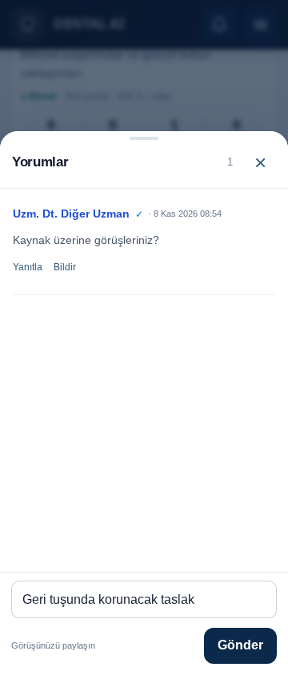
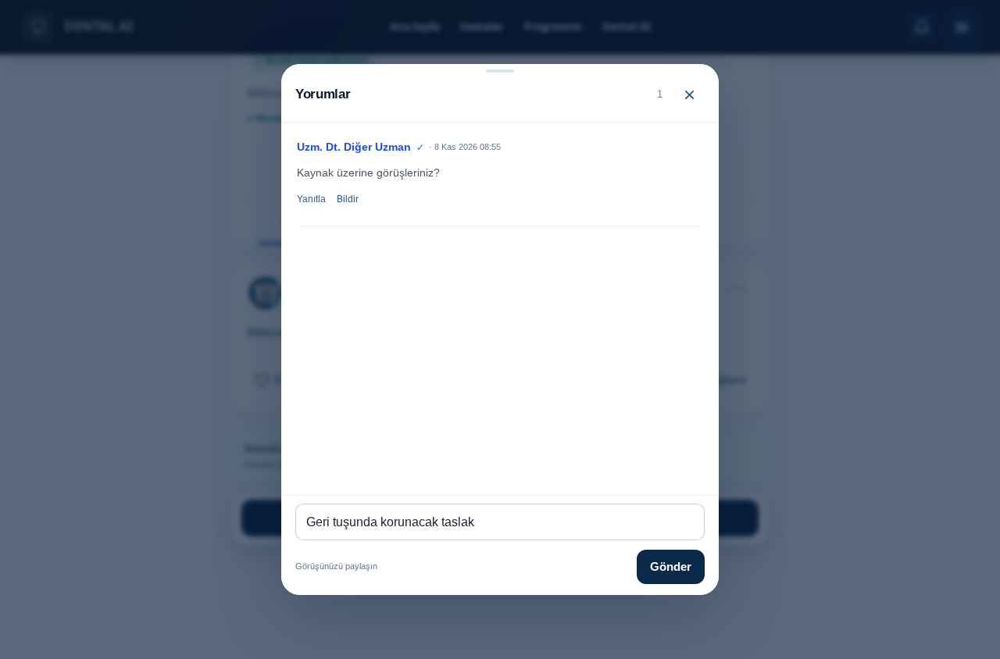
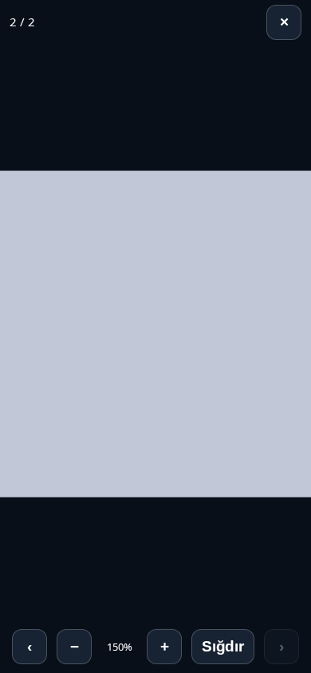
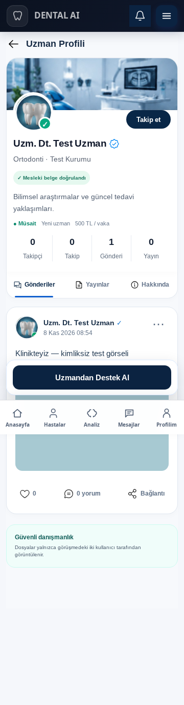
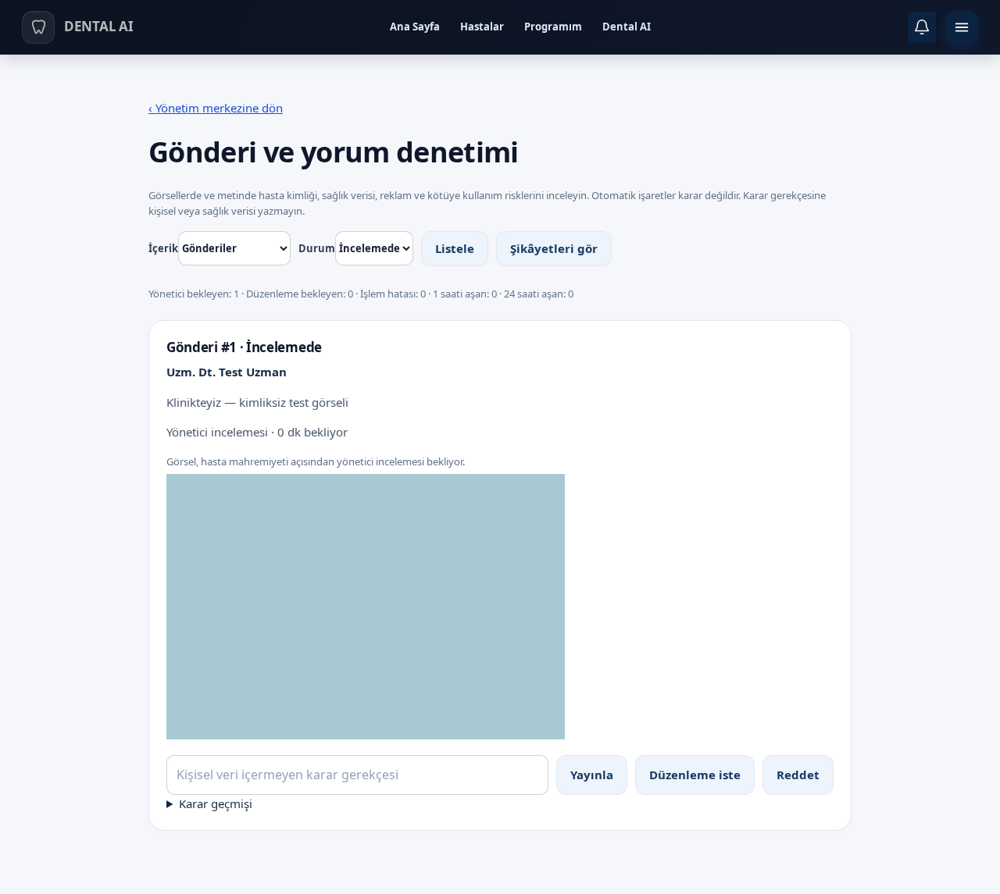

# Uzman sosyal akışı — 8 Kasım 2026

Çalışma: `feature/postlaunch-social-voice-20261107`, PR [251](https://github.com/dentalaidestek/dental-ai-v02/pull/251). Bu yeni değişiklikler main'e birleştirilmedi veya canlıya dağıtılmadı. Test hesapları ve kimliksiz veriler kullanıldı; gerçek hasta veya canlı gönderi değiştirilmedi.

## Hatalar ve kök nedenleri

| Bulgu | Kök neden | Son davranış |
|---|---|---|
| “Klinikteyiz” görseli incelemede | Mevcut politika her görseli insan incelemesine alıyordu. Harici görsel moderasyon sağlayıcısı veya çalışmayan bir AI işçisi yoktu; beklemenin nedeni gösterilmiyordu. | İnsan incelemesi korunur. İçerik başına kalıcı iş kimliği, sürüm, gerekçe, geçmiş, yaşlanan kuyruk ve yönetici kararı görünürdür. Beklemek otomatik onay sağlamaz. |
| Fotoğraf yeni sekme açıyordu | Galeri `target=_blank` bağlantıları kullanıyordu. | Aynı sayfada karartılmış görüntüleyici, geçiş, yakınlaştırma/pan/pinch, hata/yeniden yükleme, geri/Escape ve eski kaydırma konumu. Çift kapatma tek geri hareketi yapar. |
| Takip/destek kayıp sanılıyordu | Referans ekran kendi profilini gösteriyordu; kişinin kendisini takip etmesi veya kendisine vaka göndermesi zaten kapalıydı. Müsait değil mesajı ise CSS ile gizleniyordu. | Ziyaretçide takip ve belirgin “Uzmandan Destek Al”; sahibinde yönetim. Müsait değil durumu görünür. |
| Destek talebi tekrarlanabiliyordu | POST için kalıcı idempotency kaydı yoktu; aktiflik, rol, engelleme ve kapasite kontrolleri tutarsızdı. | Kapsamlı yetki kontrolü, form UUID'si ve atomik receipt. Tekrarlanan istek tek vaka/ödeme/bildirim/süre işi üretir. Eski anahtarsız istemcilerde kısa süreli aynı talep de korunur. |
| Hesap silmeyle talep kilitlenebiliyordu | Yeni receipt FK'si profil→kullanıcı; hesap silme kullanıcı→profil kilit sırası oluşturuyordu. | Katılımcılar sıralı `FOR KEY SHARE` ile profilden önce kilitlenir; mevcut sosyal yazımlarla uyum korunur, aktiflik tekrar okunur. Gerçek PostgreSQL yarışı test edildi. |
| Sabitleme etkisiz görünüyordu | İncelemedeki içeriğe de sabitle seçeneği çıkıyordu, görünür işaret zayıftı. | Yalnız yayımlanmış içerikte sabitleme; gerçek simge, tek sabit gönderi, en üst sıra ve yenilemede koruma. |
| Yorum yönetimi eksikti | Yorumlar kart içinde açılıyordu; silmede sayaç ve yanıtlar güncellenmiyordu, yazarlar düz metindi. | Mobil alt panel/masaüstü modal, geri/kapat, yanıt/düzenle/sil/bildir, doğru uzman profiline bağlantı, sunucudan güncel sayaç. Ana yorum silinince yanıtları da atomik kaldırılır. |
| Yavaş bağlantıda yorum taslağı kaybı | Eski gönderim yanıtı kaydedilmiş yeni taslağı koşulsuz siliyordu. | Yalnız gönderilen metin/yanıt/düzenleme anlık görüntüsü eşleşirse temizlenir. Geciktirilmiş gerçek tarayıcı yanıtıyla test edildi. Taslak bellektedir ve çıkışta temizlenir. |
| Yayında olmayan içeriğin nedeni bilinmiyordu | Durum etiketi vardı; özellikle yayın kartında yönetici gerekçesi gösterilmiyordu. | Gönderi/yorum/yayın gerekçesi ve “Düzenleme gerekli” durumu; yönetici kararı için özel, genel içerikli bildirim. |
| Yönetim kuyruğu sayfaları tekrarlıyordu | Son satırın değişebilir bekleme tarihinden cursor tekrar üretiliyordu. | Sabit tarih+kimlik cursor'u; sınırdaki kayıt onaylansa veya silinse de sonraki sayfa değişmez. |
| Akademik kimlik yanlış sunulabiliyordu | Kullanıcının adına yazdığı Prof./Doç. ön ekleri ve doğrulanmamış unvan doğrudan gösteriliyordu. | Profil, uzman listesi, gönderi, takip listesi ve yorumda akademik unvan yalnız doğrulama kaydından gelir. ORCID sahiplik/unvan kanıtı sayılmaz. |
| Profil geçmiş büyüdükçe ağırlaşıyordu | Performans ve profil sayaçları tüm vaka/değerlendirme nesnelerini birden fazla kez yüklüyordu. | Sabit boyutlu SQL toplamları; önceki zaman önceliği, negatif süre elemesi ve yuvarlama korunur. |

## İşlev envanteri

Çalışan ve test edilen: metin+en fazla dört görsel, sıralama/kaldırma, taslak, çevrimdışı yeniden deneme, güvenli bağlantı kartı ve önizleme hatasında sade bağlantı, beğeni/kaldırma, yorum/yanıt/düzenleme/silme/bildirme, gönderi düzenleme/silme, bağlantı kopyalama, sabitleme/kaldırma, yorum kapatma/açma, takip/kaldırma, sahibin takip listeleri, takip edilen uzman akışı, destek talebi, manuel yayın ve ORCID/DOI aktarımı.

Yorum paneli ilk açılışta listeyi yükler. Tek panel vardır; sayfalar kullanıcı isteğiyle alınır. Uzman adına/fotoğrafına dokunmak ilgili doğrulanmış uzmana gider; normal üyeye sahte uzman bağlantısı eklenmez. Başarısız gönderimde metin kalır. Kapatmak veya geri gitmek taslağı korur; panel açılır açılmaz klavye zorla açılmaz. Yorumlar kapalıyken mevcut liste okunur, yeni yazma hem UI hem API'de engellenir.

Mevcut vaka engelleme altyapısı takip/akış/destek erişiminde uygulanır. Sosyal alanda ayrı bir engelleme editörü veya yer imi/kaydet düğmesi bu sürümde eklenmedi; işlevsiz kontrol gösterilmez. Takip listeleri sahibine özeldir. Takip akışı ana sayfadaki bağlantıdan açılır; ana sayfa yüklenince yeni sosyal API çağrısı yapılmaz.

## Güvenlik ve dağıtım

Görsellerin EXIF temizliği, tür/boyut doğrulaması, Render'da kalıcı nesne deposu zorunluluğu, üyelik, aktif uzman ve sahiplik kontrolleri; SSRF/DNS/yönlendirme sınırları, CSRF koruması, metnin DOM metin düğümleriyle gösterilmesi ve paylaşılan hız sınırları korunur. Yeni AI servisi veya ücretli kaynak eklenmedi. Klinik görüntü otomatik ihlal/ret sayılmaz; insan incelemesi bekler. Otomatik kontrol hata verirse en fazla üç deneme ve kalıcı lease ile kurtarılır; insan incelemesi bekleyen içerik tekrar tekrar değerlendirilmez.

Migration eklemelidir: `socialmoderationtask`, `socialmoderationevent`, `consultationrequestreceipt` ve indeksler. Mevcut ana şema 12 ve sosyal sürüm 2 sözleşmesi korunur. Başlangıç denetimi tabloları ve receipt benzersizlik indeksini kontrol eder. Migration advisory lock ve süre sınırları kullanır; eski incelemeler en fazla 60 kayıtlık dilimlerle kaydedilir. Mevcut 60 saniyelik bakım döngüsü yalnız sınırlı backfill/hatalı iş kurtarması yapar. İnceleme sayfası geçmişin tamamını işleme sokmaz.

Canlıya alma sırası: onay sonrası DB yedeği/snapshot doğrulama → mevcut `python -m app.migrate`/startup uyumluluk yolu → readiness → yeni servis → test hesaplarıyla smoke. Eksik şema ile trafik kabul edilmemeli. Ücretsiz Render servisinde daha önce etkinleştirilmiş `DENTAL_MIGRATE_ON_STARTUP=1` yolu değiştirilmedi; plan veya ücretli worker eklenmedi.

## Doğrulama

| Koşu | Sonuç |
|---|---|
| Sosyal API, güvenlik, migration, PostgreSQL yarışları ve Chromium akışları | **206 geçti, 5 opt-in atlandı**; 141,07 sn |
| Son yorum paneli ve gecikmiş yanıt/taslak regresyonu | **5 geçti**; 14,79 sn (önceki koşudaki dört senaryoyu da kapsar) |
| Sesli muayene, mevcut danışmanlık/kimlik, depolama, auth/pool ve güvenlik | **790 geçti**; 29,86 sn |
| Gerçek ORCID/PubMed/Crossref, araştırmacı yönetim aktarımı ve galeri geri regresyonu | **6 geçti**; 61 ORCID eseri, tekrar aktarım ve DOI tekrar engeli doğrulandı |
| 60 bin sentetik hesap/gönderi/yorum/beğeni, PostgreSQL | **1 geçti**; 100 istek, 16 işçi, 4 bağlantı, 0 hata, p95 196,54 ms |
| JS sözdizimi ve `git diff --check` | Geçti |

Güncel sosyal koşuda eski testler yeni modal davranışına uyarlandı: yorum paneli kapatılmadan arkadaki beğeni düğmesine basılmaz. Auth pool test modeline üretimde zaten kullanılan rol/e-posta/MFA alanları eklendi; gerçek güvenlik kontrolü gevşetilmedi. Bağımsız incelemede bulunan cursor, çift kapatma, gerekçe, hesap silme kilit sırası ve taslak yarışları düzeltildi; son incelemede önemli/kritik açık bulgu kalmadı.

Yerel kapasite sayıları tüm internet/medya/AI/Render yükünü kapsamaz; 60 bin eşzamanlı kullanıcı garantisi değildir. Bu turda tüm depo yeniden baştan çalıştırılmadı: önceki genel koşudaki 72 başarısız akademik/PDF/diğer testin tamamı giderilmiş sayılmaz. Fiziksel iPhone/Android klavyesi, gerçek R2 yük testi ve canlı Claude sağlayıcı çıktısı doğrulanmadı. Önceki sesli muayene kod değişiklikleri ve regresyonları korunur; canlı hasta verisi harici sağlayıcıya gönderilmedi. Üretim genelinde “hata yok” iddiası yoktur.

## Değişen dosya grupları

- Backend: `app/expert_social_api.py`, `expert_social_models.py`, `expert_social_schema.py`, `expert_social_maintenance.py`; yeni `expert_social_moderation.py`, `expert_social_relationships.py`, `expert_social_identity.py`, `expert_consultation_requests.py`; mevcut profil/destek/performans fonksiyonları için `app/main.py`.
- Arayüz: `app/static/expert-social.js`, `expert-social-admin.js`, `expert-social.css`; yeni `expert-media-viewer.js` ve lisanslı `expert-icons/push-pin.svg`.
- Şablonlar: `_expert_social.html`, `expert_public_profile.html`, `expert_request.html`, `expert_support.html`, `admin_social.html`, `dashboard.html`; yeni `expert_following.html`.
- Testler: `tests/expert_social/test_{comment_sheet,consultation_entry,identity,moderation_lifecycle,relationships,social_completion_browser}.py`; mevcut tarayıcı/kapasite/PostgreSQL/migration testleri ve `tests/test_database_auth_capacity.py`.

## Test ekranları

