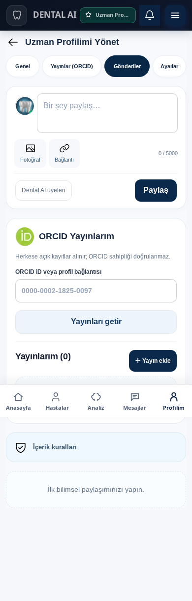
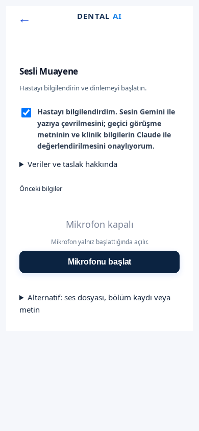
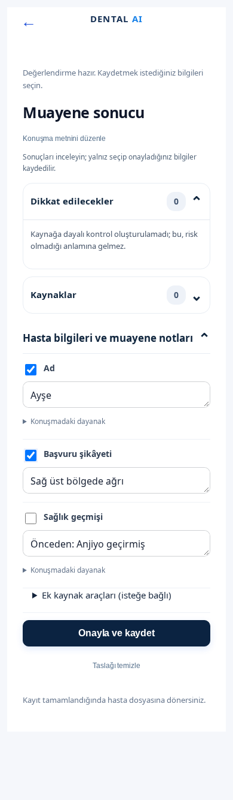

# Yayın sonrası uzman profili ve sesli muayene — 7 Kasım 2026

## Canlı durum ve dağıtım onarımı

Başlangıçtaki durum kullanıcının beklediğinden farklıydı: PR250 main’e birleştirilmişti ancak Render dep-dbnmng142hec73ck872g dağıtımı, dental_social_revision tablosu bulunamadığı için 18:21 UTC’de başarısızdı. Canlı sürüm 802c28 olarak kalmıştı. Gerçek servis ücretsiz/tek instance; render.yaml içindeki starter/preDeploy ayarı bu servise uygulanmamış.

Mevcut, önceden onaylanan sürüm için tek ayar DENTAL_MIGRATE_ON_STARTUP=1 birleştirildi (diğer değişkenler değiştirilmedi). Mevcut kodun serialized/advisory-lock migration uyumluluk yolu kullanıldı. Gerçek PostgreSQL’de önce mevcut 12 → sosyal yükseltme testi geçti. Render ortam değişikliği otomatik dağıtım başlattı; ikinci bir deploy tetiklenmedi. dep-dbnmrcajnfac73cqrdqg,565df06a7b7775d2ec2466656ee92b497d2cdf58 sürümüyle 18:29:47 UTC / 21:29:47 Türkiye saatinde live oldu. Ücretli plan alınmadı. Kendi oturumunda yeni uzman editörü/yayın sekmesi ve sesli muayene başlangıcı tarayıcıda okundu; gerçek hasta alanları değiştirilmedi.

Bu rapordaki YENİ kod düzeltmeleri feature/postlaunch-social-voice-20261107 dalındadır; henüz main’e birleştirilmedi veya canlıya dağıtılmadı. Free servis startup uyumluluk ayarı korunur. İleride render.yaml’a senkronizasyon yapılacaksa plan/preDeploy farkı ayrıca gözden geçirilmelidir; bu dosyayı otomatik uygulamadık.

## Yapılan düzeltmeler

- Sosyal gönderi/yorum yazarken rate admission ve yönetici MFA kontrolü artık kilitli içerik işlemi içinden ikinci bağlantı istemez. Bir bağlantıyla yazma ve dört eşzamanlı yazar/dört PostgreSQL bağlantısı test edildi.
- Yavaş isteklerde toplam 30 saniye gövde alma sınırı, parça sayısı yerine byte temelli tampon var. Eksik sonsuz gövde tek yükleme yerini süresiz tutmaz. Eski 1 byte/20 bin parça örneğinde 3,85 MB meta veri tutulduğu testte görüldü; artık tek bounded gövde olarak işlenir.
- Uzman yetkisinde aktiflik, mesleki doğrulama ve uygun hesap rolü kontrol edilir. Doğrulanmış ADMIN uzman korunur; yalnız yönetici olmak uzmanlık sağlamaz. Yetkisi düşürülen profil paylaşamaz.
- ORCID en fazla 500  eseri tek aktarımda alır; sınırı aşarsa açık hata verir, kısmi kayıt bırakmaz. Yayın ve denetim satırları iki toplu INSERT ile kaydedilir; tekrar kontrolleri yalnız aday yayınları sorgular. Aziz Sancar’ın 61 eser aktarımı, tekrar aktarım, DOI tekrar engeli ve gönderiye taşıma gerçek API/UI testinde yeniden geçti.
- Depolama temizliği DB bağlantısı serbest bırakıldıktan sonra yapılır. Geçici silme hatası kalıcı outbox’a bırakılır. Moderasyon/DOI süre sonu indeksleri mevcut tablolara eklenir; temizlik en fazla 500 satırlık dilimlerdir. İndeks değişiklikleri mevcut sosyal şema 2 sözleşmesini korur; yeni readiness gerekli indeksleri de doğrular. Eski uygulamanın yeniden başlaması/geri dönüşü için gereksiz şema 3 şartı getirilmedi. Temel şema 12 kalır.
- Claude son değerlendirmesi artık yalnız çıkarılmış alanları değil, desteklenen tam geçici görüşme metnini de alır (72.000 karakter). Ad-soyad ve tanınabilen doğrudan kimlik/iletişim bilgileri yerelde azaltılır; özel hayatı tamamen ayıklama/anonimleştirme garantisi verilmez. Araştırma sorgularına tam konuşma gönderilmez. Muayene/iş kayıtlarına tam metin eklenmez.
- Aynı muayenenin eşzamanlı son değerlendirmesi tekrarlanmaz; anahtar sunucunun bildiği kullanıcı+hasta ve içerik özetinden oluşur. Ayrı hastalar aynı şikâyeti bildirdiğinde birbirlerini gereksiz engellemez. Koruma processlocaldır. Paylaşılan provider bütçeleri/concurrency korunur; günlük/aylık harcama üst sınırı operatör yapılandırmasına bağlıdır.
- Sesli arayüz tek başlangıç başlığına indirildi; tekrar eden hazır etiketleri kaldırıldı. Mikrofon düğmesi aktarım onayından önce pasiftir. Capabilities isteği iki yerine bir kez yapılır. Taslak her harfte senkron depolamaya yazılmaz; 250 ms geciktirilir, sayfa kapanırken son hali hemen yazılır. Çıkışta hem muayene hem sosyal taslaklar temizlenir ve son sayfa olayı bunları geri oluşturamaz; diğer tercihler korunur.
- Uzman yönetiminde eski serbest yayın formu ile yeni yapılandırılmış yayın alanının tekrarı giderildi; eski veri gizli form alanlarında korunur. Referanstaki editör→ORCID/yayınlar→içerik kuralları sırası uygulandı; kendi gönderileri altta kalır. Klinik kapak/avatar, rozetler, sekmeler ve boşluklar referansa göre düzenlendi. Sayılar gerçek API verisidir; çalışmayan video/anket düğmeleri eklenmedi.

## Claude’un görevi ve sınırları

Gemini ses→metin; Claude yapılandırılmış klinik çıkarım; default claude_web modunda Claude’un sınırlandırılmış kamusal kaynak araştırması; ardından tek Claude son değerlendirmesi. Tam konuşma eklemek yeni bir model aşaması eklemez, ancak metin uzunluğuna göre giriş token maliyeti artabilir. Kaynak araştırmasında process içi kamusal önbellek, en fazla 2 arama/3 sayfa alma bütçesi ve doğrulanmış konu kimlikleri korunur. Bu bütçe her diş hekimliği işlem/materyalinin eksiksiz kaynak kontrolünü garanti etmez. Kaynakla desteklenmeyen bilgi otomatik hekim hatası veya güvenli kabul edilmez. Klinik doğruluk, kaynak kapsamı ve gerçek konuşma tanıma kalitesi hekim değerlendirmesi gerektirir.

Canlı Claude denemesi mevcut bir hasta oturumunda aktarım onayı gerektirdi. Otomatik onay denetimi, oturumda özel sağlık verisi bulunma ihtimali nedeniyle tıklamayı reddetti. Tıklama ilerletilmedi; yeni provider isteği veya hasta kaydı yapılmadı. Canlı Claude çıktısı doğrulanmış olarak sunulmaz. Bağımsız kimliksiz test oturumunda yalnız kurgu metninin Claude’a gönderilmesi için açık onay gerekir. Kod ve yerel entegrasyon testleri gerçek sağlayıcı yanıtı değildir.

## Ölçüm

Yerel, sentetik PostgreSQL deneyinde 60.000 hesap + 60.000 gönderi + 60.000 yorum + 60.000 beğeni, 16 eşzamanlı işçi ve 4 bağlantı havuzuyla 100 API okuması yapıldı. 0 hata; en çok 4 bağlantı; p50 = 74,22 ms, p95 = 168,33 ms; 173,63 istek/s. İlk sayfa 11, eski cursor sayfası 10 SQL sorgusuydu; depodaki satır sayısı kadar sorgu oluşmadı. Bunlar yalnız bu koşunun ölçümüdür.

Kapsam: yerel sosyal FastAPI router, gerçek oturum doğrulama ve PostgreSQL. Worker başlangıcı, tüm sayfa middleware’i, internet/CDN, gerçek R2, medya işleme ve AI bu ölçüme dahil değildir. 100 istek dayanıklılık/soak testi değildir. 60.000 kayıtlı hesap ile 60.000 eşzamanlı aktif kullanıcı ayrıdır. Mevcut ücretsiz tek instance’ın 60.000 eşzamanlı kullanıcıyı taşıdığı iddia edilmez. Canlı sunucuya stres yükü uygulanmadı; plan büyütülmedi.

## Doğrulama

**Hedefli regresyon: 868 geçti, 5 opt-in test atlandı (69,20s).** Sosyal API/güvenlik, gerçek PostgreSQL/migration/yazma yarışı, mevcut danışmanlık/kimlik/depolama/MFA, bütün sesli muayene modülleri ve Chromium mobil akışları birlikte çalıştı. JavaScript sözdizimi ve git diff --check geçti. **Genel depo: 2202 geçti, 72 başarısız, 53 atlandı; 594 alt test geçti (417,39s).** Başarısız test kimlikleri önceki baseline/özellik koşusuyla karşılaştırıldı; yeni başarısız kimlik yoktu. Bu genel koşu, mevcut akademik/PDF/destek test sorunlarının giderildiği veya bütün sitenin yeşil olduğu anlamına gelmez. Ayrı sonuç dosyası full-suite-comparison.json içindedir. Gerçek ORCID/PubMed/Crossref+Chromium yönetim aktarımı: 5 test geçti. Yerel kapasite deneyi: 1 test geçti. Bağımsız incelemede hastalar arası hatalı deduplikasyon bulundu, başarısız regresyonla doğrulanıp düzeltildi; son incelemede önemli/kritik yeni bulgu kalmadı.

Başlangıçtaki iki ilaç corpus testinin nedeni üretim eksikliği değildi: yeniden oluşturulmuş yerel checkout’ta dosya eksikti. main’deki app/data/voice_drug_sources.jsonl birebir geri alındı (Git blob e665733239c20a5248feeafbe08b8dbd39a0263f); 9 ilaç kaynak testi geçti. Kaynak içeriği uydurulmadı, üretim dosyası değiştirilmedi.

Fiziksel iPhone/Safari klavyesi, 60 bin eşzamanlı oturum, gerçek R2 throughput ve klinisyen etiketli duyarlılık/özgüllük testi yapılmadı. Görsel denetim ilk sürümde insan incelemesidir; yerel metin moderasyonu tüm ihlalleri yakalama garantisi vermez.

